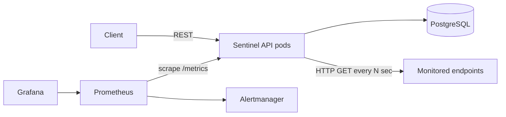
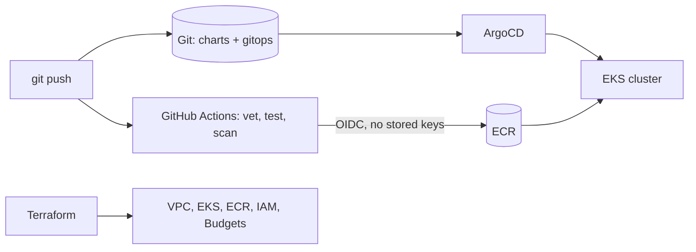

# Architecture

## What the product does
**Sentinel** is a Go service that periodically health-checks HTTP endpoints you register, stores every
result in PostgreSQL, exposes a REST API (targets, results, uptime summaries) and publishes Prometheus
metrics. It is the "workload"; the rest of the repo is the platform that builds, secures, deploys,
observes and recovers it.

## Request / data flow

## Delivery flow

## Key design decisions (be ready to defend these)
| Decision | Why | Trade-off |
|---|---|---|
| Modular monolith (API + checker in one binary) | Simple to operate and reason about | Checker can't scale independently; split later if needed |
| Go stdlib `net/http` + `database/sql` | Few dependencies, small attack surface | More boilerplate than a framework |
| Embedded, versioned SQL migrations with a Postgres advisory lock | Safe with several replicas starting at once; no extra tooling | Forward-only (no down migrations); move to a dedicated tool if you need rollbacks |
| Distroless, non-root, read-only-FS container | Minimal attack surface | No shell for debugging (use `kubectl debug`) |
| SSRF guard on target URLs (validation + dial-time IP check) | The service makes outbound calls to user-supplied URLs | Private targets are unreachable unless `ALLOW_PRIVATE_TARGETS=true`; an egress proxy would add defence in depth |
| GitOps with ArgoCD | Git is the source of truth; drift is auto-corrected | Extra component to operate |
| Single NAT gateway, SPOT nodes in dev | Cost | Lower availability; use per-AZ NAT and on-demand in prod |
| In-cluster Postgres in dev, RDS recommended for prod | Cheap to learn on | Not production-grade (no PITR, single replica) |
| OIDC from GitHub to AWS | No long-lived credentials | Needs IAM trust policy scoped to the repo/branch |

## Known limitations (honest list)
- Per-target Prometheus labels are fine for tens of targets, not thousands (cardinality).
- Auth: static service tokens + optional OIDC JWT (one optional role check; no per-endpoint RBAC).
- Check scheduling is global (one interval for all targets).
- Single region; dev uses a single shared NAT gateway (`single_nat_gateway=false` gives one per AZ) and (by default) in-cluster Postgres.
- Node scaling: the EKS node group has fixed min/max sizes (HPA scales pods, nothing scales nodes automatically on EKS; AKS has the cluster autoscaler enabled). Karpenter is not set up.
- Terraform is validated in CI but never planned/applied by CI: that needs cloud credentials and a manual approval step, so apply is intentionally manual.
- Kyverno policies start in Audit mode; the ACR/ECR credential helpers must be validated in a real cluster before Enforce.
